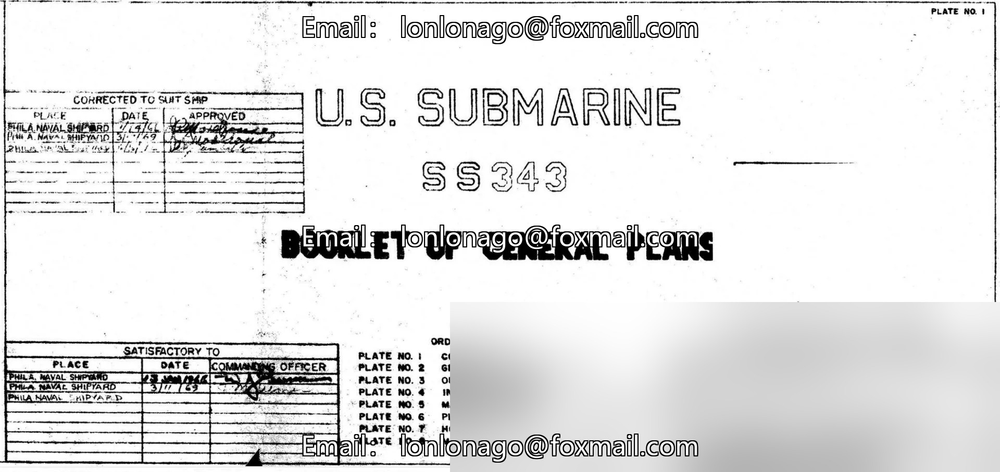
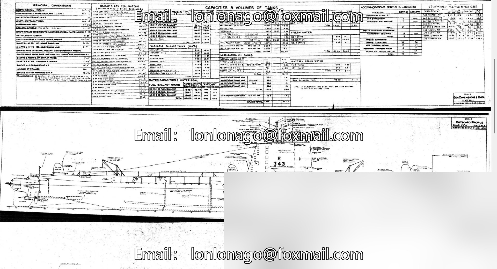
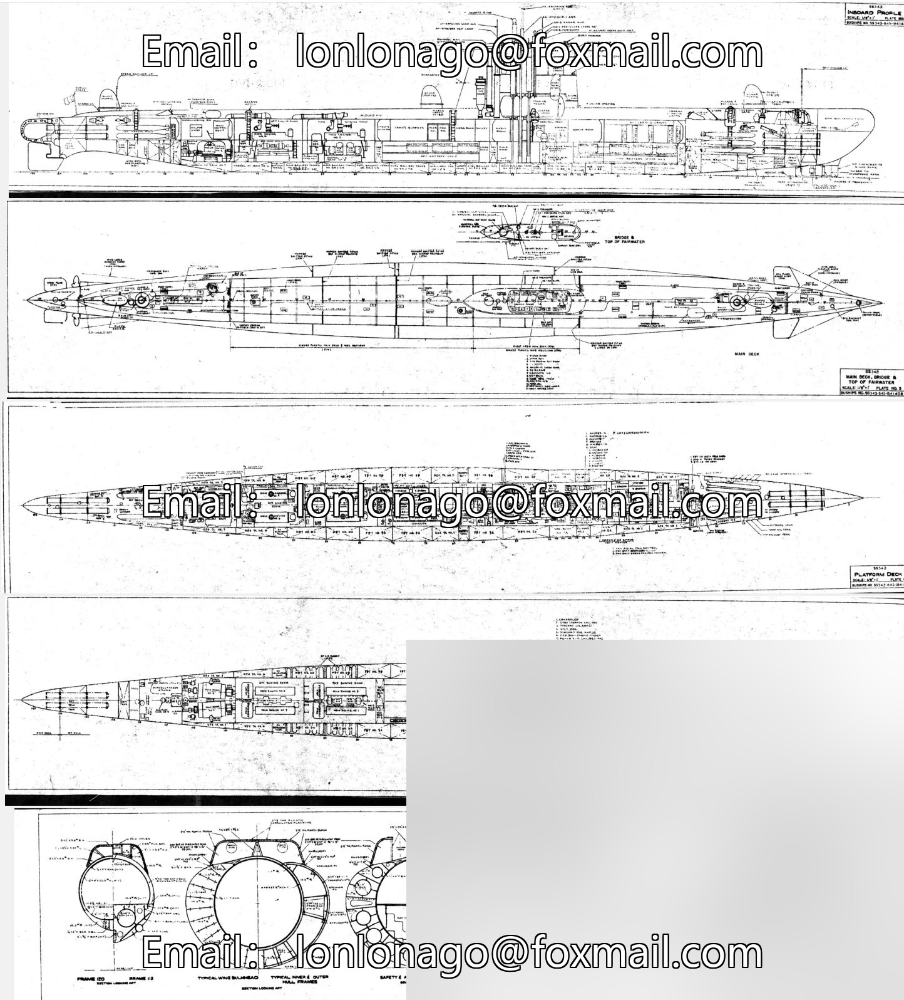
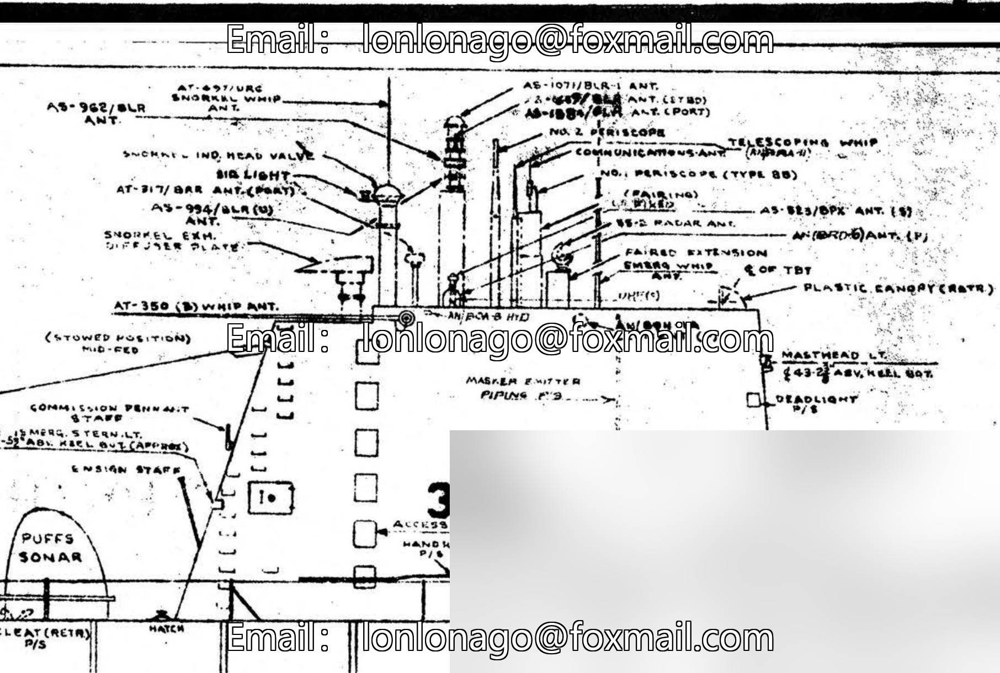

# American Navy SS-343 submarine (USS Clamagore)

## Body

The general arrangement drawing book of USS Clamagore (USS SS-343), version of the 1969 long-jaw must fish (GUPPY III Class) conversion.
1. Contents of the materials
1. Overall dimensions and performance parameters of the ship
2. Plane arrangement maps of each deck layer
3. Outline contour line maps
4. Interrupted surface maps
5. Layout of main cabin areas
6. Storage space planning
7. Communication and navigation equipment configuration
8. Tactical data and capacity statistics
2. Characteristics description
- Detailed annotation of functional area divisions for each cabin
- Clearly displaying the positions of weapons and equipment
- Providing key system interface information
- Including a ship-body structural parameter table
are copyable and will not be refunded upon sale.

The US Navy SS-343 submarine overall layout booklet covers the 1969 GuPPY III-class modification, including total dimensions, floor plans, outer contour lines, interruption faces, cabin layouts, storage planning, communication and navigation equipment, tactical data and capacity statistics.

<!-- AI_ENRICHED -->

## Images

## Payment

Here is a pay link on Stripe ( https://buy.stripe.com/3cs8yP7sY87d0vu9AB ). Please contact me lonlonago@foxmail.com after funding $89, and I will send you a complete data files , thank you!

